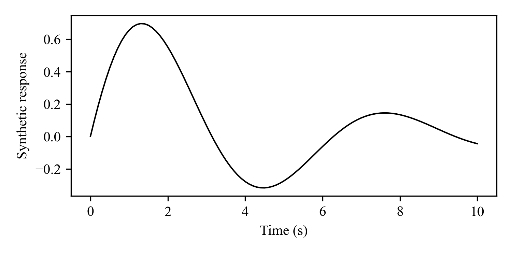

**Synthetic integration fixture**

Affiliation: Local software validation, not a submitted research manuscript.

## Abstract {.unnumbered}

This synthetic manuscript exercises a local document workflow. It checks template formatting, editable equations, figure and table numbering, and cross-references. The numerical values are test fixtures and are not research results.

Keywords: Document workflow; Editable equations; Cross-references

# 1 Introduction

The input table and response plot use synthetic data. Both appear in the manuscript with numbered captions.

# 2 Methods

The editable dynamics equation is included to exercise mathematical notation and its reference, Eq. ([[REF dynamics]]).

$\mathbf{M}\ddot{\mathbf{x}}+\mathbf{C}\dot{\mathbf{x}}+\mathbf{K}\mathbf{x}=\mathbf{f}(t)$ [[EQNO dynamics]]

The matrix is an independent conversion fixture.

$\mathbf{A}=\begin{bmatrix}1&2\\3&4\end{bmatrix}$ [[EQNO matrix]]

# 3 Fixture output

Figure [[REF response]] comes from fixture-data.csv generated by make_example.py. It contains synthetic values.

{width=13cm}

[[CAPTION Figure response|Synthetic response used for software validation]]

The values in Table [[REF results]] are editable Word table cells.

[[CAPTION Table results|Synthetic fixture values]]

| Case | Value |
|:-----|------:|
| A | 1.25 |
| B | 2.50 |

# 4 Conclusion

This document demonstrates software behavior only. It reports no scientific findings.
